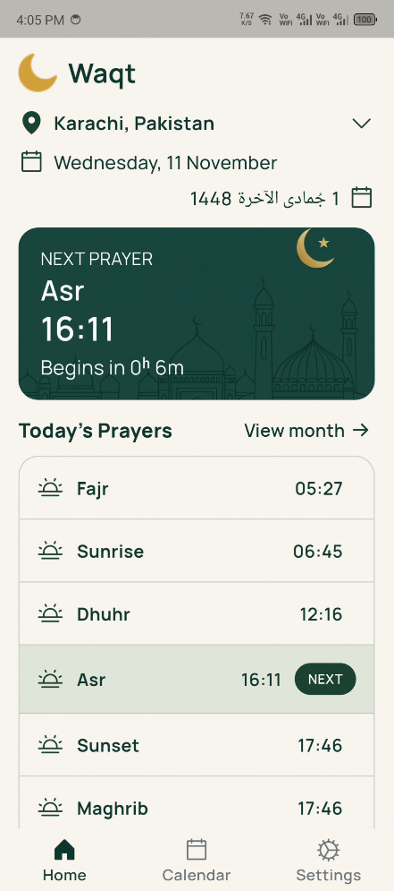
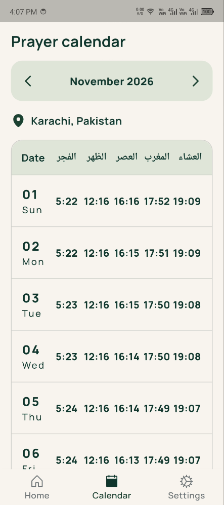
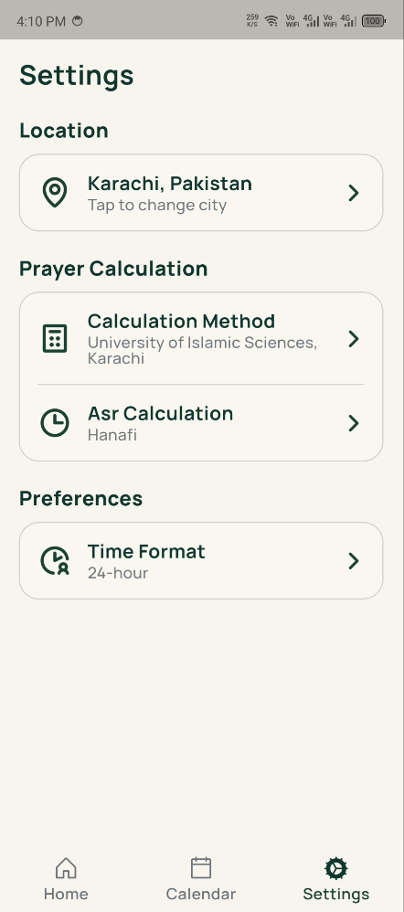

# Waqt

Waqt is a Flutter prayer-times app for checking daily prayer times and viewing a prayer calendar for a selected location.

## Features

- View daily prayer times and the upcoming prayer.
- Search for and select a location.
- Browse prayer times by month.
- Choose prayer calculation and Asr methods.

## Screenshots

| Home | Calendar |
|---|---|
|  |  |

| Location search | Settings |
|---|---|
|  |  |

| Splash screen |
|---|
|  |

## Getting started

### Requirements

- Flutter SDK (Dart is included with Flutter)
- An internet connection to retrieve prayer times and search locations

### Run the app

```bash
git clone https://github.com/shahzaibalijamro/waqt.git
cd waqt
flutter pub get
flutter run
```

## Data sources

Waqt retrieves prayer times and calculation methods from the [AlAdhan API](https://aladhan.com/prayer-times-api), and location search results from [Open-Meteo Geocoding](https://open-meteo.com/en/docs/geocoding-api).

## Download

The Android APK will be attached to a release on the [GitHub Releases page](https://github.com/shahzaibalijamro/waqt/releases).

## License

This project is licensed under the MIT License. See [LICENSE](LICENSE) for details.
